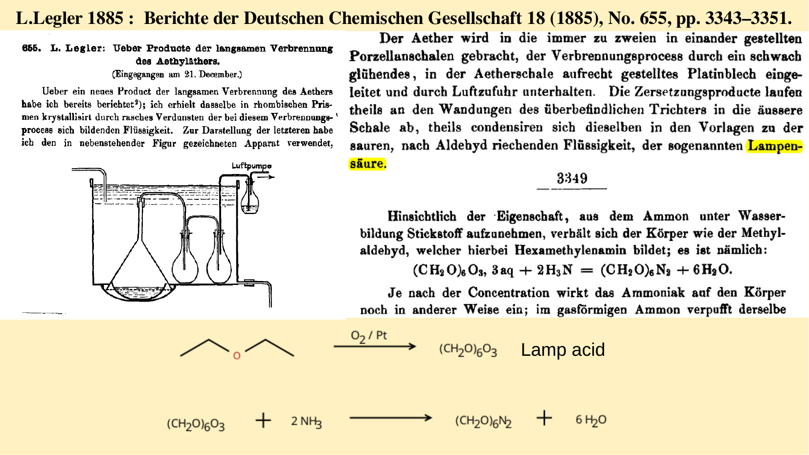
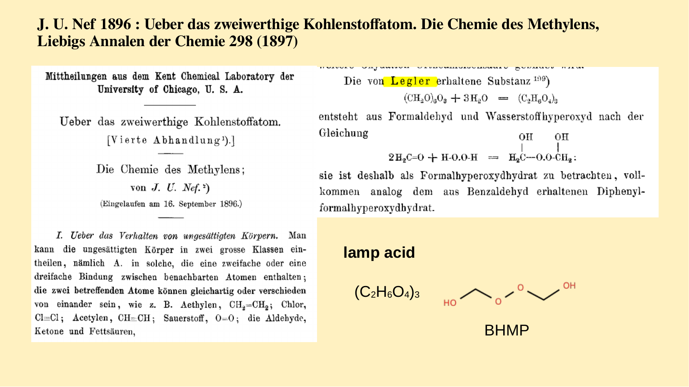
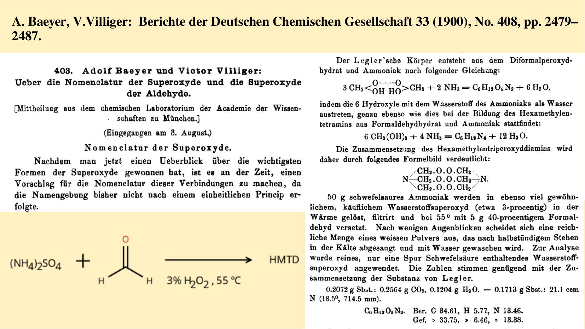
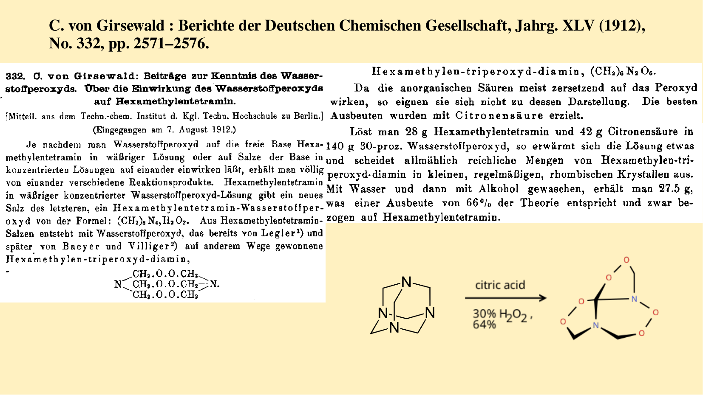

# HMTD (hexamethylenetriperoxidediamine)

This repository documents the historical discovery and synthetic method of HMTD , with the original sources provided as PDFs. Some of the articles were originally written in German. English translations are also included.

## Brief History

HMTD is known for a high explosive organic peroxide compound. 
It was originally intended for use in detonators, but owing to its instability, it failed to displace mercury fulminate, which was the prevailing choice at the time. Today, its facile and inexpensive synthesis has made it a component of choice in HMEs and terrorist activities.

HMTD was first synthesized in 1855 by the German chemist L. Legler. His article concerned the oxidation of diethyl ether, but he serendipitously obtained "Lamp acid" by oxidizing diethyl ether with O₂ over Pt under harsh conditions. He subsequently treated Lamp acid with ammonia to afford HMTD. Notably, Legler was unable to correctly identify the structure of Lamp acid, and his synthetic method was inefficient; he reported obtaining only a trace amount of HTMD.

In 1897, J. U. Nef identified the Lamp acid obtained by Legler as a trimer of BHMP. He also elucidated the mechanism of Legler's oxidation: diethyl ether is oxidized to give formaldehyde, hydrogen peroxide, acetaldehyde, acetic acid, and formic acid, among which hydrogen peroxide and formaldehyde react to form BHMP (Lamp acid).

In 1900, A. Baeyer and V. Villiger, building on Nef's work, provided an accurate account of how Legler had obtained HMTD through the oxidation of diethyl ether. They also determined the chemical structure of HMTD, which remains the accepted structure today. Furthermore, they modified the synthetic procedure by employing ammonium sulfate, formaldehyde, and hydrogen peroxide. However, they did not report the yield of HT obtained by this method.

In 1912, C. von Girsewald reported an efficient synthesis of HMTD based on the decomposition of hexamine with hydrogen peroxide in the presence of citric acid. This method is still widely used today and remains the most efficient route known. He reported a yield of 64%. Through explosion experiments, he also demonstrated that HMTD is more hazardous than mercury fulminate.









## Synthetic method

```
 HMTD is a powerful explosiVe. A 125 mL three-neck flask equipped with a paddle-type microstirrer was charged with 7.00 g (50 mmol) of hexamethylenetetramine and 23 mL of 50% H2O2 and chilled to ∼0 °C (ice/NaCl). While being stirred,11.5 g (54.7 mmol) citric acid monohydrate was added in 10 small portions over the course of 2 h. The clear solution was stirred at ∼0 °C for an additional 8 h; the ice-bath was removed,and the solution was allowed to warm slowly to room temperature. The resultant opaque mixture was stirred for an additional 2 h, the micro-stirrer was removed, and the flask containing the product was re-chilled in ice for 30 min. The white crystalline material was gravity filtered and then rinsed with 3 × 50 mL ice water, followed by 2 × 20 mL ice-cold CH3OH
rinses. The crystalline material and filter paper was dried in a vacuum desiccator (CaSO4) overnight to afford 5.75 g (27.6
mmol; 55%) product: mp ) 152-153 °C (exp.) (lit. mp ) 144-145 °C;17 154 °C18); 1H NMR (CDCl3): δ 4.80; 13C NMR δ 90.44.
```
## Reaction mechanism

## References

All papers mentioned above are available in the [articles/](articles/) directory. The German PDFs are too old to render on GitHub, so please download them locally.

| File Name | Journal |
|-----------|---------|
|[legler1885.pdf](articles/legler1885.pdf)|Berichte der Deutschen Chemischen Gesellschaft 18 (1885), No. 655, pp. 3343–3351. |
|[legler1885_en.pdf](articles/legler1885_en.pdf)|English translation made by Claude Opus 5.0|
|[nef1897.pdf](articles/nef1897.pdf)| Annalen der Chemie 298. (1897)|
|[nef1897_en.pdf](articles/nef1897_pp328-329_en.pdf)|English translation made by Claude Opus 5.0. The only relevant part is translated|
|[baeyer_villiger_1900.pdf](articles/baeyer_villiger_1900.pdf)|Berichte der Deutschen Chemischen Gesellschaft 33 (1900), No. 408, pp. 2479– 2487. |
|[baeyer_villiger_1900_en.pdf](articles/baeyer_villiger_1900_en.pdf)|English translation made by Claude Opus 5.0|
|[girsewald1912.pdf](articles/girsewald1912.pdf) | Berichte der Deutschen Chemischen Gesellschaft, Jahrg. XLV (1912), No. 332, pp. 2571–2576.|
|[girsewald1912_en.pdf](articles/girsewald1912_en.pdf)|English translation made by Claude Opus 5.0

 
 
